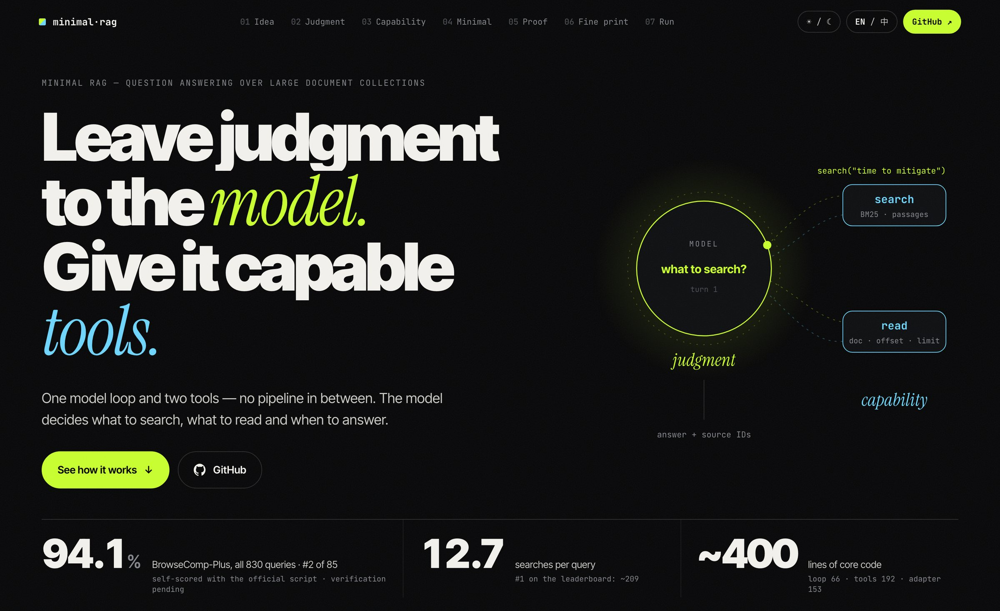
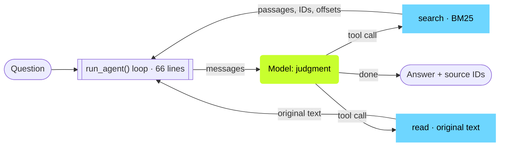

<p align="center">
  <a href="https://hxli2005.github.io/minimal-rag/">
    <picture>
      <source media="(prefers-color-scheme: light)" srcset="docs/assets/hero-light.jpg">
      
    </picture>
  </a>
</p>

<h1 align="center">Minimal RAG</h1>

<p align="center">
  <b>94.1% on BrowseComp-Plus (all 830 queries) with one agent, plain BM25 and ~400 lines of core code.</b><br>
  单智能体 + 纯 BM25 + 约 400 行核心代码，BrowseComp-Plus 全量 830 题 94.1%。
</p>

<p align="center">
  
  
  
  
</p>

<p align="center">
  <a href="https://hxli2005.github.io/minimal-rag/"><b>Website</b></a> ·
  <a href="https://hxli2005.github.io/minimal-rag/notes/search-read/">Interface case study</a> ·
  <a href="https://medium.com/@lihaoxiang05/the-rag-result-list-is-not-the-evidence-4982b28986db">Medium edition</a> ·
  <a href="#results">Results</a> ·
  <a href="#quick-start">Quick start</a> ·
  <a href="REPRODUCE.md">Reproduce</a> ·
  <a href="experiments/README.md">Experiments</a> ·
  <a href="#中文说明">中文</a>
</p>

---

## The idea

> **Leave judgment to the model and give it capable tools.**
> 判断交给模型，能力交给工具。

A typical RAG pipeline makes its decisions in code before the model sees the question. Minimal RAG hands every decision to the model and keeps only two tools:

| 🟢 The model decides | 🔵 The tools provide | ✕ Deleted |
| --- | --- | --- |
| what to search · whether to search again · what to read and how much · when to stop and what to cite | `search(query, limit)`: original passages ranked by SQLite FTS5 BM25, each with document ID and character offset<br>`read(document_id, offset, limit)`: original text at any position | embeddings · reranker · router · fixed top-k prompt |

The design aims to let the system benefit directly from stronger models: no decision is hard-coded in the loop, so there is no pipeline to re-tune. Every question keeps an inspectable trace, configuration and evaluation record.

## At a glance

**Status:** submitted to the BrowseComp-Plus and EnterpriseRAG-Bench maintainers; verification pending.

| | Minimal RAG | Leaderboard #1 (2026-10-17) | Best BM25-only entry |
| --- | ---: | ---: | ---: |
| BrowseComp-Plus accuracy | **94.10%** | 95.18% | 90.48% |
| Model | gpt-6.1-sol | GPT-5 | GPT-5.5 |
| Architecture | **Single agent** | Multi-agent | — |
| Searches per query | **12.7** | ~209 | 33.7 |
| Retrieval | **BM25** | Hybrid dense (Qwen2-7B + Reason-ModernColBERT) | BM25 + query expansion |

- 🏁 **#2 of 85 entries on the public Agents leaderboard as of 2026-10-17**, and the highest single-agent and BM25-only entry. Scored by us with the official evaluation script; maintainer verification pending.
- 🔧 **The gain comes from tool-interface design, not only the model.** With the same model, BM25 index and 230 queries, replacing our search/read tools with the benchmark's standard search tool drops correct answers from 217 to 194: +10.0 pp for our interface, paired 95% CI [5.2, 14.8].
- ✂️ **No embeddings, reranker or fixed pipeline.** Core loop 66 lines, search/read 192 lines, model adapter 153 lines (tag `frozen-20261017`).

## How it works



The model replies with text or tool calls; the loop runs the tools and appends their results. That is the entire control flow.

Core code: [loop.py](src/minimal_rag/loop.py) · [indexed_rag.py](src/minimal_rag/indexed_rag.py). The frozen results use the [Codex adapter](src/minimal_rag/codex_adapter.py); a direct Responses API [adapter](src/minimal_rag/api_adapter.py) is also provided. Links point to current code; to reproduce the frozen results, use the pinned version in [REPRODUCE.md](REPRODUCE.md).

## Results

| Benchmark | Result | Evaluation |
| --- | ---: | --- |
| **BrowseComp-Plus**, all 830 queries | **781/830 = 94.10%** | Official scoring script + Qwen3-32B BF16, run by us; submitted, verification pending |
| **EnterpriseRAG-Bench**, 500 questions | Local test400: **309/400 = 77.25%**; dev100: 74/100 | Local `gpt-6.1-sol` judge; all 500 answers submitted in the official format, official grading pending |
| FinanceBench, 100 questions | 83/100 | Local judge; retrieval over a shared corpus of all 371 filings; earlier search description |
| HotpotQA distractor, 100 questions | EM 77.0 / F1 87.25 | Official answer metric on public dev data; supporting facts not evaluated |

Generation model: `gpt-6.1-sol` (reasoning effort high), run through the Codex SDK.

- **BrowseComp-Plus:** recall 88.13%, calibration error 1.44%, 3.4 reads per query. Eight queries failed for technical reasons during generation (timeouts, usage limits and SDK interrupts) and were rerun once with the same configuration before grading. Counting them as incorrect gives 775/830 = 93.37%, still #2.
- **EnterpriseRAG-Bench:** our local judge is stricter than the official one. On the same 400 questions, the public CDL answers are judged correct 86.5% locally and 92.0% officially. On the official leaderboard, OpenAI File Search scores 69.8% and "BM25 + GPT-5.4, single pass" 68.8%.

[BrowseComp results](experiments/browsecomp-frozen-judge-20261017/result.json) · [Enterprise export provenance](evidence/frozen-enterprise-export-20261017.json) · [Reproduction guide](REPRODUCE.md)

## Quick start

Python 3.12+. Run these commands from an empty directory on macOS or Linux. The demo calls no model and needs no account:

```bash
python3.12 -m venv .venv
.venv/bin/python -m pip install https://github.com/hxli2005/minimal-rag/archive/refs/heads/main.zip
.venv/bin/python -m minimal_rag demo
```

It builds a real SQLite index from bundled samples and replays search → read → cited answer. Next: [index your own documents and ask a live model](docs/quickstart.md). Detailed runtime and evaluation notes are in the [runbook](docs/runbook.md).

## Design decisions

Each is a paired comparison on the same questions; what lost stays on record. [Experiment index](experiments/README.md)

| Tried | Result | Decision |
| --- | --- | --- |
| Separate vector retrieval tool (Qwen3-Embedding-8B, alongside BM25, model picks) | Enterprise test400: 305 vs 309 | ✕ Dropped |
| ripgrep corpus-wide Grep tool | Enterprise dev100: 78 vs 74, about 3 wins traceable to Grep; BrowseComp dev30: 28 vs 28 | ◐ Optional, off by default |
| Answer verbosity `verbosity=high` | Fixed evidence, 30 questions: 22 vs 23 (low) | ✕ API default stays low |
| Direct API instead of the Codex transport | Enterprise dev30: 24 vs 22, fact completeness 93.0% vs 84.7% | ✓ Kept as a portable backend |

## Fine print

- A personal student project. Under budget limits, the direct API backend was only migration-tested on Enterprise dev30; all full-benchmark results come from Codex SDK runs.
- Both benchmarks were used during development, and Enterprise dev/test is our own split, so they are regression sets, not held-out sets. Apart from reruns after technical errors and resumed interruptions, each question got one generation; the first valid judgment is kept and failures stay in the denominator.
- Codex injects extra tool definitions and multi-agent instructions and sets `verbosity=low`; no built-in tool calls appear in the traces. [Probe record](evidence/codex-hidden-context-20261017.json)
- BrowseComp judging ran on a single A800, with only `max_model_len=8192` added to the official script. The longest judge prompt is 1,216 tokens, so nothing is truncated. [Engine adjustment](experiments/browsecomp-frozen-judge-20261017/engine-adjustment.json)
- The BrowseComp full run with the earlier search description, 772/830 = 93.01%, is kept as a historical record.

---

## 中文说明

**判断交给模型，能力交给工具。** 典型的 RAG 流水线在模型看到问题之前就用代码定好了查询改写、路由、检索器、top-k 和提示词。Minimal RAG 把这些决定全部交给模型，只保留两个工具：`search` 用 SQLite FTS5 BM25 给原文段落排序并返回文档 ID 和字符偏移；`read` 按文档 ID 和偏移返回任意位置的原文。没有向量、重排序或固定流水线；循环里不写死任何决定，模型变强，系统直接受益。

**成绩：** BrowseComp-Plus 全量 830 题 781 题正确（94.10%），2026-10-17 公开 Agents 榜 85 个条目中第 2，单智能体与纯 BM25 条目中最高；由本项目用官方脚本判分，等待维护方复核。EnterpriseRAG-Bench 本地 test400 为 309/400（77.25%），500 题答案已按官方格式提交，等待官方判分。同一模型、同一索引、同样 230 题下，把 search/read 换成基准标准搜索工具，答对数从 217 降到 194（+10.0 个百分点，配对 95% 置信区间 [5.2, 14.8]）。

**快速开始：** 命令见上方 [Quick start](#quick-start)。演示用内置样例建立真实 SQLite 索引，回放“检索 → 读取 → 带来源回答”，不调用模型、不需要账号。真实问答、资料建库和 API 配置见[运行指南](docs/runbook.md)。

### 设计取舍

每项都是同题配对对照，未采用的方案同样保留记录。[实验索引](experiments/README.md)

| 尝试 | 结果 | 决定 |
| --- | --- | --- |
| 独立向量检索工具（Qwen3-Embedding-8B，与 BM25 并列，由模型选择） | Enterprise test400：305 vs 309 | 不采用 |
| ripgrep 全库 Grep 工具 | Enterprise dev100：78 vs 74，逐题追溯能归因于 Grep 的约 3 题；BrowseComp dev30：28 vs 28 | 可选，默认关闭 |
| 回答详细度 `verbosity=high` | 固定证据 30 题：22 vs 23（low） | API 默认 low |
| 直连 API 替代 Codex 传输 | Enterprise dev30：24 vs 22，事实完整度 93.0% vs 84.7% | 作为可移植后端保留 |

### 口径与限制

- 本项目为个人学生项目。受预算限制，直连 API 后端只在 Enterprise dev30 上做过迁移验证；全量成绩均来自 Codex SDK 运行。
- 两个基准都在开发中使用过，Enterprise 的 dev/test 是本项目自己的划分，属于回归集而不是留出集。除技术错误后的重跑和中断续跑外，每题一次生成；保留首次有效判决，失败计入分母。
- BrowseComp 有 8 题在生成时遇到技术故障（超时、额度和 SDK 中断），判分前用相同配置各重跑一次；把它们算错则为 775/830 = 93.37%，仍是第 2。
- Codex 运行时会注入额外的工具定义和多智能体说明，并设定 `verbosity=low`；轨迹中没有出现内置工具调用。[探测记录](evidence/codex-hidden-context-20261017.json)
- BrowseComp 判分在单张 A800 上运行，只在官方脚本里增加了 `max_model_len=8192`。最长的判分提示为 1,216 token，不会截断。[引擎调整](experiments/browsecomp-frozen-judge-20261017/engine-adjustment.json)
- 本地 Enterprise 裁判比官方更严：同 400 题上，公开 CDL 答案本地判对 86.5%，官方 92.0%。
- 旧版 search 说明的 BrowseComp 全量结果 772/830 = 93.01% 作为历史记录保留。

---

<p align="center">
  <a href="https://hxli2005.github.io/minimal-rag/">Website</a> ·
  <a href="REPRODUCE.md">Reproduction guide</a> ·
  <a href="docs/runbook.md">Runbook</a> ·
  <a href="docs/issues.md">Issues</a> ·
  <a href="THIRD_PARTY_NOTICES.md">Third-party notices</a>
</p>
