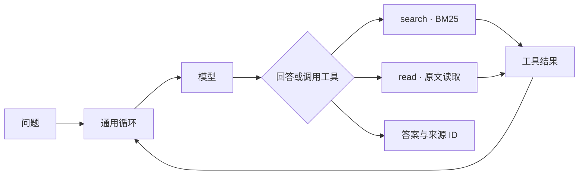

# Minimal RAG

> **单智能体 + 纯 BM25 + 约 400 行核心代码，BrowseComp-Plus 全量 830 题 94.1%。**
>
> *94.1% on BrowseComp-Plus with one agent, plain BM25 and ~400 lines of core code.*

| | Minimal RAG | 榜首（2026-10-17） | 纯 BM25 条目最高 |
| --- | ---: | ---: | ---: |
| BrowseComp-Plus 准确率 | **94.10%** | 95.18% | 90.48% |
| 模型 | gpt-6.1-sol | GPT-5 | GPT-5.5 |
| 架构 | **单智能体** | 多智能体 | — |
| 平均每题搜索次数 | **12.7** | 约 209 | — |
| 检索 | **BM25** | 混合稠密检索（Qwen2-7B + ColBERT） | BM25 + 查询扩展 |

- **若按 2026-10-17 公开的 Agents 榜（85 条）排名，位列第 2**，并且在单智能体和纯 BM25 条目中都是最高。成绩已按官方评分脚本自行评测，待维护方核实。
- **提升来自接口设计，而不只是模型。** 同一模型、同一 BM25 索引、同 230 题，把 search/read 换成官方标准 search 工具，正确数从 217 降到 194；我们的接口高 10.0pp，配对 95% 区间 [5.2, 14.8]。
- **没有向量检索、重排模型或预设流程。** 模型自己决定搜什么、读哪里、何时回答：`search` 用 SQLite FTS5 BM25 检索原文，`read` 按文档 ID 和字符位置读取。核心循环 66 行，检索与读取 192 行，模型适配 153 行（标签 `frozen-20261017`）。

**判断交给模型，能力交给工具**：系统随模型能力提升直接受益，每题都保留可检查的轨迹、配置和评测证据。

## 全部成绩

| 基准 | 结果 | 评测口径 |
| --- | ---: | --- |
| **BrowseComp-Plus**，全量 830 题 | **781/830 = 94.10%** | 官方评分脚本 + Qwen3-32B BF16，自行运行，已准备提交 |
| **EnterpriseRAG-Bench**，500 题 | 本地 test400：**309/400 = 77.25%**；dev100：74/100 | 本地 `gpt-6.1-sol` 裁判；500 题答案已按官方格式导出，待官方判分 |
| FinanceBench，100 题 | 83/100 | 本地裁判，在全部 371 个财报文件构成的共享库中检索；旧版 search 说明 |
| HotpotQA distractor，100 题 | EM 77.0 / F1 87.25 | 官方答案评分公式，公开 dev 数据；未评测支持句 |

生成模型为 `gpt-6.1-sol`（reasoning effort high），经 Codex SDK 运行。

- **BrowseComp-Plus：** 召回 88.13%，校准误差 1.44%，平均每题 3.4 次 read。生成阶段 8 题因超时等技术错误，在判分前按相同配置重跑过一次；按失败计为 775/830 = 93.37%，同样排第 2。
- **EnterpriseRAG-Bench：** 本地裁判比官方严。同 400 题上，CDL 公开答案本地判对 86.5%，官方判对 92.0%。官方榜上，OpenAI File Search 为 69.8%，“BM25 + GPT-5.4 一次回答”为 68.8%。

[BrowseComp 结果](experiments/browsecomp-frozen-judge-20261017/result.json) · [Enterprise 导出证据](evidence/frozen-enterprise-export-20261017.json) · [复现指南](REPRODUCE.md)

## 架构



核心实现：[loop.py](src/minimal_rag/loop.py)、[indexed_rag.py](src/minimal_rag/indexed_rag.py)。冻结成绩使用 [Codex 适配器](src/minimal_rag/codex_adapter.py)；另提供直连 Responses API 的[适配器](src/minimal_rag/api_adapter.py)。链接指向当前代码；复现冻结成绩请按 [REPRODUCE.md](REPRODUCE.md) 使用固定版本。

## 快速开始

Python 3.12+。以下演示不调用模型，也不需要账号：

```bash
python3.12 -m venv .venv
.venv/bin/python -m pip install -e .
.venv/bin/python -m minimal_rag demo
```

演示用内置样例建立真实 SQLite 索引，回放“检索 → 读取 → 带来源回答”。真实问答、资料建库和 API 配置见[运行指南](docs/runbook.md)。

## 设计取舍

每项都是同题配对对照，未采用的方案同样保留记录。[实验索引](experiments/README.md)

| 尝试 | 结果 | 决定 |
| --- | --- | --- |
| 独立向量检索工具（Qwen3-Embedding-8B，与 BM25 并列，由模型选择） | Enterprise test400：305 vs 309 | 不采用 |
| ripgrep 全库 Grep 工具 | Enterprise dev100：78 vs 74，逐题追溯能归因于 Grep 的约 3 题；BrowseComp dev30：28 vs 28 | 可选，默认关闭 |
| 回答详细度 `verbosity=high` | 固定证据 30 题：22 vs 23（low） | API 默认 low |
| 直连 API 替代 Codex 传输 | Enterprise dev30：24 vs 22，事实完整度 93.0% vs 84.7% | 作为可移植后端保留 |

## 口径与限制

- 本项目为个人学生项目。受预算限制，直连 API 后端只在 Enterprise dev30 上做过迁移验证；全量成绩均来自 Codex SDK 运行。
- 两个基准都在开发中使用过，Enterprise 的 dev/test 是本项目自己的划分，属于回归集而不是留出集。除技术错误后的重跑和中断续跑外，每题一次生成；保留首次有效判决，失败计入分母。
- Codex 运行时会注入额外的工具定义和多智能体说明，并设定 `verbosity=low`；轨迹中没有出现内置工具调用。[探测记录](evidence/codex-hidden-context-20261017.json)
- BrowseComp 判分在单张 A800 上运行，只在官方脚本里增加了 `max_model_len=8192`。最长的判分提示为 1,216 token，不会截断。[引擎调整](experiments/browsecomp-frozen-judge-20261017/engine-adjustment.json)
- 旧版 search 说明的 BrowseComp 全量结果 772/830 = 93.01% 作为历史记录保留。

[复现指南](REPRODUCE.md) · [运行指南](docs/runbook.md) · [问题清单](docs/issues.md) · [第三方来源](THIRD_PARTY_NOTICES.md)
