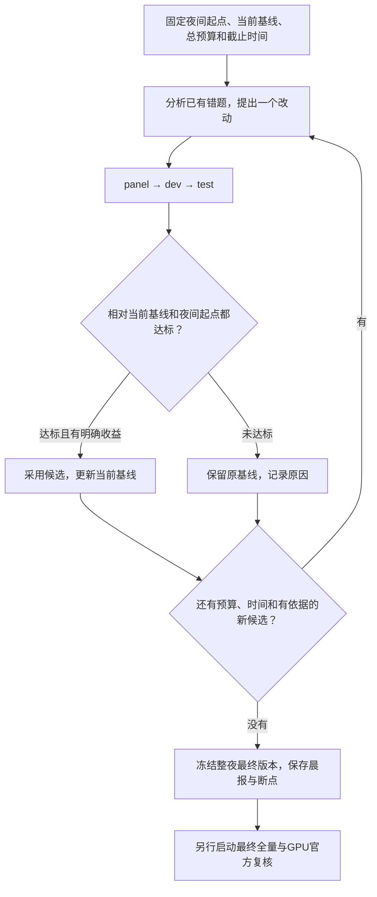

# 多基准夜间持续优化循环

**每次只试一个候选，主评分只用BrowseComp-Plus和EnterpriseRAG-Bench；沿用panel、dev、test流程，决定采用或拒绝后自动进入下一轮。FinanceBench单列辅助，Hotpot不参与主评分或晋级。GPU官方判分只在整夜筛选结束后做。** 已知题被反复使用，结果不自动构成未见数据上的泛化证明。

本文件是 2026-10-15 夜间循环的协议记录，循环已结束、未重新启动；当前待办见 [issues](../../docs/issues.md)。

## 本次用户复核决定

2026-10-15用户明确表示“v3可以通过，之前标准太严”，因此v3按用户复核通过并采用，后续优化基线为v3。以下数值门槛保留为本夜原自动协议，旧gate文件不重算、不伪装为原门槛通过；本次决定不自动定义下一轮的新阈值。v3的Enterprise test400仍未运行，先不开新实验的指令继续有效。[采用决定](../system-v3-20261015/adoption.json)

## 基准分工

| 基准 | 定位 | 是否参与主评分、主成本比和晋级 |
| --- | --- | --- |
| BrowseComp-Plus | 首要目标：自主search/read | 是；夜间用固定dev100，最终版本另验剩余730题 |
| EnterpriseRAG-Bench | 第二主目标：企业资料问答 | 是；dev100、夜间test400 |
| FinanceBench | 金融领域辅助佐证 | 否；最终版本可单列dev50及成本，不加分、不否决晋级 |
| HotpotQA distractor | 历史结果与可选排查资料 | 否；本夜默认不运行，预算0，不影响主样本分母 |

主评分中的“每个基准”只指BrowseComp和Enterprise。Finance/Hotpot的分数、成本和缺判状态都不能进入主合并指标、双基线门槛或最终版本选择；历史成绩和原始数据保留。

## 整夜流程

外层由Codex负责读轨迹、提出候选、修改实验装配、解释结果和发起下一轮；运行器只执行已冻结的候选、记账、评分和返回阶段状态。启动一个后台评测进程不等于实现了这个外层循环。

## 整夜总预算与截止

以下是首次运行的默认值，仅用于计划；实际启动前写入 `data/benchmarks/system-nightly/<night_id>/night-plan.json`。用户可在启动前覆盖；恢复或更换候选不重置总预算和截止时间。

| 项目 | 默认值 |
| --- | --- |
| 运行时间 | 实际启动起8小时，保存明确的start_at、deadline_at；对用户显示America/Los_Angeles时间 |
| 全夜sol请求上限 | 10,000次应用层请求：9,000次用于主探索、归因及辅助检查，最后1,000次只留给已有答案补判与收尾 |
| 候选上限 | 最多3个，含首候选v1；被拒绝和无法完成的候选也占名额 |
| 并发 | 生成5、裁判独立1；429只影响出问题的一侧 |
| 新候选截止 | 剩余不足90分钟，或估算资源不足以完成其必要评测链路时，不再新开候选 |
| 收尾窗口 | 最后30分钟不发起生成请求；已有答案可补判，到deadline_at停止全部实验请求 |

- 总账包括所有候选、基线补齐、生成、sol裁判、失败、重试与恢复，也包括单列的Finance辅助检查；复用历史结果不重复计数。OpenRouter调用次数、模型响应次数和已返回费用另记，补判受同一截止时间约束。辅助结果不参与晋级，不代表它的调用不计预算。
- 每次请求发起前，原子检查并记录阶段预算、整夜预算和截止时间，任一不满足就不发起。阶段上限不是额外赠送的额度。
- 每次进入下一阶段，按同类题已观测的请求量和耗时估算剩余工作并记录。没有数据时用brief的预计数；另留20%的资源余量。预算或时间不足就保存为incomplete，不缩样本、不改门槛、不挪用GPU阶段预算晋级。
- 已经在途的请求只等待原180秒请求超时与夜间剩余时间两者的较小值；截止仍未结束则保存可恢复中断。截止导致的未完成阶段不判通过，也不冒充质量失败。
- 时间到、总预算到、探索额度耗尽、候选名额用完、没有有依据的新候选、usage limit、权限阻塞，任一发生就收尾。阻断整轮的启动/装配故障最多做两次有记录的恢复；仍不能继续就保存阻塞原因。单题裁判连接失败按补判规则处理，不套用这个两次装配恢复限制。
- 最后30分钟同时用于补判、离线汇总、版本账本和提交；没有收益也正常结束。不能自动延长8小时或把新夜间窗口当作原任务的续跑额度。
- 应用层账本不覆盖SDK内部不可观测的HTTP重试，也不等于当前聊天自身的总token消费。实验脚本额外发起的模型调用必须计入账本。

## 自动提出并接力执行候选

1. 首候选是[system v1](brief.md)。当前基线初始为v0；Enterprise和BrowseComp的主基线均已有结果，核对配置后复用。主流程不为Finance或Hotpot补开发基线。
2. 每轮结束后，检查当前基线和该候选的逐题差异、失败类别、工具轨迹与成本，提出一个有证据支持的通用改动。优先删除冗余，再考虑给模型增加通用能力。
3. 在新的版本目录写brief：父版本、唯一改动、依据、预期作用、固定参数、样本、两个比较对象、预计请求与耗时。在线调用前提交。不得把同一失败设置换名重试，不写题号、标准答案或基准专用解题分支。
4. 从当前已采用基线开始实现，在实验目录独立装配。每个候选和阶段独立输出目录及子进程，保留全部尝试；不覆盖失败候选，不通过重置整个工作区丢弃用户改动。
5. 运行下方原有panel/dev/test流程。局部质量失败只结束这个候选，记录原因并继续提下一个；不停止整夜，也不立即转去等GPU。
6. 主流程三道门槛通过且有明确收益才替换当前基线：主评分统计支持的提分、主任务成本下降，或明确删掉依赖／分支／重复实现且主任务成绩与成本仍达标。辅助基准的收益不能替代主流程收益，持平但没有实质收益时保留旧基线。
7. 立即写版本账本与简短报告，再检查剩余资源。满足条件就自动接下一轮，不等待用户逐轮发指令。未采用的候选不得成为下一轮默认父版本。

纯装配修复可留在同一候选，原失败尝试和账本保留；若修复改变了被测模型输入、工具行为或其他候选变量，则按新候选记录并计入名额，不覆盖旧版本。

本夜不自行更换生成模型、effort、裁判、语料、固定样本、评分公式或单题调用上限。后续候选可调整通用检索装配、返回内容、通用提示或工具能力，每次只改一处；`src/`和评分实现保持原样。v1是历史栈向当前核心的显式迁移组合，不能声称它是单一检索因素的实验。换模型或增加预算留给另一次预先授权并冻结的实验。

## 每个候选的主评分流程

| 阶段 | 主评分题目 | 门槛 | sol请求上限 |
| --- | --- | --- | ---: |
| panel | Enterprise dev前30＋BrowseComp固定dev100列表前30，共60题 | 两个主基准分别胜题数−负题数≥−2 | 600 |
| dev | Enterprise100＋BrowseComp100，共200题；两基准各50%权重 | 每主基准差值≥−2pp；合并配对差95%区间下界≥−2pp；主任务未缓存输入比≤1.10 | 1,400 |
| test | 仅Enterprise test400已知回归；不混入其他基准的dev题 | Enterprise差值≥−2pp、配对差95%区间下界≥−2pp、未缓存输入比≤1.10 | 2,800 |

- Enterprise panel按其dev文件原顺序；BrowseComp panel按`experiments/browsecomp-full-20261015/sample-dev100.json`原顺序前30个ID，不另抽样。完整dev包含panel，后续只补余下各70题。
- 各阶段预算包括该阶段候选和必要主基线的新请求，并共享整夜上限；不是每轮预分配额度。v1的Enterprise归因组改为700次上限，只在dev通过且资源足够时跑一次，不参与晋级；其他候选不自动追加。
- v1的BrowseComp panel/dev与A-lean配置一致时直接复用；后续候选只要改变有效配置，就先跑其自己的panel30，通过后补齐dev100，分别计入600/1,400阶段上限，不能借用旧分数。
- dev通过只允许进入Enterprise test400。test通过才可成为夜间current_best，但其BrowseComp剩余730题尚未验证；不能写成两个主基准的完整test均已通过。未通过按质量回退、成本超限或证据不足区分。
- 提分只在合并配对差区间下界>0时表述，并注明相对哪个基线。更简单的系统持平可以胜出，成本允许最多+10%，不能预设“更省”。

## Finance辅助与Hotpot历史资料

- 夜间主循环停止提出新候选、最终current_best冻结后，若剩余资源能在最后30分钟生成截止前完成，最多单列一次Finance dev50辅助检查；与night_anchor的同题结果比较，缺少的基线dev50只补一次，候选/基线/裁判/失败/补判合计上限500次sol请求，仍计整夜10,000总账。
- Finance辅助不跑每个候选，也不额外跑test100；已有Finance历史test100保留展示。最终版本等于anchor时直接保留已有证据，无需生成两份相同系统结果。资源不足或辅助缺判则记录未完成，不阻塞主门槛和晨报。
- Finance只报告自己的正确率、配对差、缺失和成本，不加入任何主得分、主成本比、bootstrap合并或采用/淘汰条件；辅助结果不能让夜间已冻结的最终版本改选。
- Hotpot本夜不调用模型，预算0；已有EM/F1和工具代码仅保留作历史或另行排查使用，不自动开新检查。

## 防止多轮累计退步和涨价

- `night_anchor`固定为开夜时已采用版本的代码、配置和各基准结果，整夜不变；`current_best`是最近一次通过门槛并采用的版本，初始等于anchor。基线缺少的结果可以按固定配置补齐，配置不能借补齐之机改变。
- 每个候选的主流程同时对current_best和night_anchor逐题比较：panel的两个主基准分别过关，dev200的两套主合并比较都过关，Enterprise test400的两套比较也都过关。第二套比较复用anchor结果，不重复调用模型。
- 主dev/test按上述固定题集和权重独立判断，不混入Finance/Hotpot或跨阶段拼分。这样−2pp和+10%是相对夜间起点的主任务底线，不会每轮累计放宽。
- 成本缺失不当作确定的零：候选用量缺失时成本门槛为undetermined，不能采用；候选完整、基线有缺失时，用基线已记录成本作为下界计算保守成本比上界，只有上界≤1.10才通过，并注明不是精确节省率。
- 夜间结束时冻结current_best作为最终版本；没有候选采用就保留anchor。不根据后续全量或GPU分数改换候选，不按题拼接多个版本的最佳答案。

## 计分与统计

- 主评分只有Enterprise本地sol裁判正确率和BrowseComp的Qwen3-32B代理裁判准确率；Finance的sol判分单列辅助，Hotpot历史EM/F1不进入本夜统计。
- 按固定题号配对。已结束的生成失败按答错计，不需要补造裁判；有效答案缺判决则先补判。只要必要配对未齐，阶段就是undetermined，不能晋级。
- 主dev200每题按0/1，Enterprise/BrowseComp各50%，按基准分层bootstrap 10,000次、seed 20261016；test只对Enterprise400逐题bootstrap，同次数和seed，不声称跨基准合并test。两个比较基线分别计算。
- 主未缓存输入＝主任务输入token−主任务缓存输入token；主dev以200题、Enterprise test以400题为分母，覆盖这些题全部生成尝试。Finance、Hotpot和裁判用量都不混入主成本门槛，另列明细；它们实际消耗的请求仍进入总资源账本。

## 运行器与夜间续办

- 一题一份轨迹，阶段只是固定题号子集；后续阶段只补缺题，不直接用旧评测器的`--limit`加`--resume`扩样。已完成题和首次有效判决不重跑。
- 复用BrowseComp已有的账本、独立子进程和断点机制。一次只跑一个候选；生成与裁判并发分别管理。429只处理出问题侧并冷却后继续；usage limit和权限阻塞停止整夜，不绕过、不改CODEX_HOME。
- 未完成及因额度、限流、截止中断的尝试保留后再恢复；权限阻塞须等外部授权条件实际改变后才恢复。超时等已结束失败保留为错题，不按分数重跑。
- 裁判最多3次模型响应，解析失败也占一次；连接失败及不含模型响应的HTTP错误单列并进入补判队列，不占响应次数，但sol请求仍占阶段和整夜预算。判定前统一补齐所需评分，到截止仍未补齐就不晋级。
- 只需night计划、当前候选／阶段、anchor/current_best引用、账本、deadline及停止原因等状态。恢复前核对父进程和实际阶段子进程，防止重复启动；不能靠重启重置计数。
- 真实启动夜间任务时，外层必须有当前聊天的持续执行或定时续办机制，能在后台阶段完成后继续设计下一候选。每10分钟核对账本和进程，无变化时保持安静；异常、需要用户处理或整夜结束时通知。仅编写本方案不会启用或恢复现有已暂停巡检。
- 首次在线调用前离线验证：已知A-lean对A的+3pp、4胜1负；主样本60/200/400无重复；任意改变Finance/Hotpot分数或用量均不改变主门槛；预算600/1,400/2,800及全夜10,000有效；恢复、双基线、自动接力和截止不失效。验证不调用模型、不新建测试套件。

## 收尾与官方GPU评测

- 晨报主表只列BrowseComp/Enterprise及其对两个比较基线的成绩和主成本；Finance另表，Hotpot只链接历史。另写候选/改动、最终版本/commit、全部请求/耗时/补判次数、停止原因与未完成事项。每轮提交代码与摘要，最终提交晨报和版本账本；不推送、不改main。
- 未完成候选保留为未完成，current_best不被它替换。退出实验子进程并暂停本次夜间续办，不自动进入下一晚。
- 只在夜间结束、最终版本冻结后进入[BrowseComp官方复核](../browsecomp-final-20261015/brief.md)。最终是v0/A时复用A830；最终是v1且配置一致时复用A-lean dev100；最终是后续版本时使用该版本自己的dev100。
- 最终候选的BrowseComp剩余730题与GPU判分是**另行启动的收尾评测阶段**，仍按7,000次sol上限单独记账和指定截止时间，不计入夜间test400或整夜10,000。没有GPU时先留包和操作说明，不阻断夜间候选接力；730题验证前只称夜间回归候选，不宣称两个主基准全量均不退步。
- 同机两块H800以TP=2共同运行一个官方Qwen3-32B BF16裁判；只评整夜最终版本及必要对照，GPU分数不倒流为本夜继续调参的反馈。提交文件只准备，不发送或上传到榜单。

## 产出和限制

| 位置 | 内容 |
| --- | --- |
| `data/benchmarks/system-nightly/<night_id>/` | night-plan、night-state、统一请求账本和原始运行材料，不提交Git |
| 各候选实验目录 | brief、notes、参数、阶段摘要、离线验证及代码版本；保留未采用候选 |
| [docs/versions.md](versions.md) | 当前基线、夜间anchor、各阶段对两者的判定与采用状态 |
| `experiments/reports/system-nightly-<night_id>.md` | 一页晨报与最终版本，提交Git |

- dev和test都是已知开发或回归集。多轮选择后的区间不涵盖挑候选的选择效应及生成/裁判重复波动，不等于未见数据上的保证。
- baseline v0仍按历史适配器/检索快照复现，新候选按自己的冻结装配运行。改动实验不改写历史分数。
- 本方案规定如何执行；运行器和外层接力需要实现并验证。任务承诺持续尝试和完整记录，不承诺每晚一定提分。
